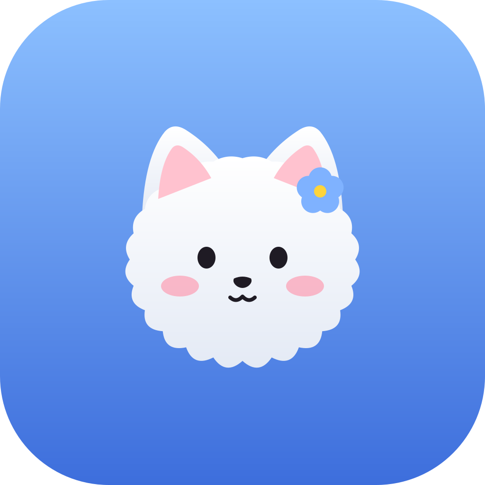

# Embarrass Me Not



A small menu bar app for the Mac that keeps your speakers quiet when your
headphones go, and gives Background Sounds the controls Control Center
leaves out.

## What it does

**When your AirPods (or any Bluetooth headphones) disconnect** — back in the
case, out of range, or over to your iPhone — the Mac usually carries on
through its speakers, out loud, in front of everyone. Embarrass Me Not mutes
whatever the sound falls back to, and stops the background sounds, so a quiet
room stays quiet. When the headphones come back, it unmutes what it muted.
Choosing the speakers yourself while the headphones are still connected is
left alone.

**Background Sounds** (rain, ocean, noise and the rest, from System Settings
▸ Accessibility ▸ Audio), all from the menu bar:

- on and off, and which sound
- the volume, and the volume while other media plays
- whether they keep playing with media, and whether they stop when the Mac locks
- a sleep timer: stop after 15 minutes up to 8 hours
- start them by themselves when headphones connect

Nothing leaves your Mac: no network, no analytics, no account.

## Two builds

| | Build from source (`make`) | App Store (`make appstore`) |
|---|---|---|
| Mutes the speakers when headphones disconnect | ✓ | ✓ |
| Background Sounds | Apple's own | its own, made from noise |
| Sandboxed | no | yes |

Apple's Background Sounds can only be reached through a private macOS
framework (`HearingUtilities`), which the App Store doesn't allow. So the
build from source controls Apple's
(`EmbarrassMeNot/BackgroundSounds.swift`, compiled only with
`BACKGROUND_SOUNDS`), and the App Store build plays sounds it makes itself
(`Core/Sources/EmbarrassMeNotCore/Ambience.swift`). A macOS update could
change the private framework; if it does, the build from source falls
back to its own sounds too.

## Building from source

You need a Mac with macOS 14 or later and Xcode 16 or later. Nothing else:
no package manager, no Apple developer account.

```sh
git clone https://github.com/wtermini/embarrassmenot.git
cd embarrassmenot
make run        # builds "build/Embarrass Me Not.app" and opens it
make install    # or copies it to /Applications
make test       # the tests
```

Or open `EmbarrassMeNot.xcodeproj` in Xcode and press Run.

The app is signed to run on your own Mac only. To sign it with your own
Apple team, create `Config/Local.xcconfig` (it's ignored by git):

```
DEVELOPMENT_TEAM = ABCDE12345
CODE_SIGN_IDENTITY = Apple Development
```

## How it's put together

- `Core/` — a Swift package with what the app decides, tested with
  `swift test` and no hardware: `SpeakerGuard` (when to mute) and the
  sound generator.
- `EmbarrassMeNot/` — the app: Core Audio (`AudioOutputs.swift`), Apple's
  Background Sounds, the sound player and the menu.
- `Art/` — the dog, drawn in code (`make icons` draws the app and menu bar
  icons again from `Art/draw.py`).
- `Config/` — build settings for the three configurations: Debug, Release
  (build from source) and AppStore.

## Licence

Apache License 2.0 — see [LICENSE](LICENSE) and [NOTICE](NOTICE).

The code is yours to use, change and share. The name "Embarrass Me Not" and
the dog icon are not part of the licence: if you publish your own version,
give it its own name and icon.
